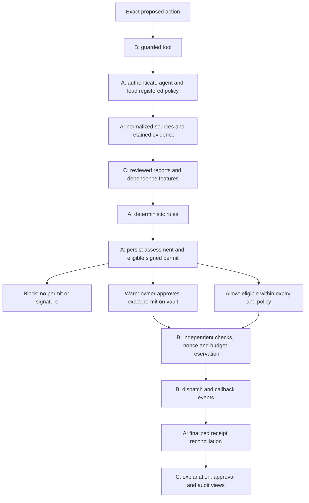

# Person A — full execution plan

Owner: **Medhansh (A: data and decisions)**. Baseline: 8 November 2026. Budget: eight three-hour packages, **24 active hours**, within the team's 72 person-hours. This is an implementation checklist, not evidence that functionality exists. A-owned backend implementation now exists; see [the handoff](person-a-handoff.md) for actual checks and pending B/C integration gates. The package sequence and estimates below remain the planning baseline.

## 1. Understand the whole product

Counterparty Guard checks the exact payment or supported contract call before an agent signs. It explains account state, age/activity, contract identity/changes, the authenticated agent's finalized history, and shared evidence-backed reports. Its differentiator discounts manufactured activity and dependent reports without declaring common ownership or treating popularity as proof of safety.



The three contributors are trust-boundary owners as well as implementers. A decides whether evidence supports authorization; B independently checks that the signed authorization is usable; C supplies moderated reports, explainable dependence features and the visible evidence. The scorer, agent, owner and reviewer remain separate credential roles.

MVP: native NEAR transfers and one configured fixture-contract method, fixtures plus local sandbox and testnet, source provenance, signed single-use permits, restricted keys, independent human warning approval, complete scenarios and actual attack logs. OutLayer and a real model adapter are stretch work. No mainnet spending, arbitrary contract analyzer or wallet platform.

## 2. Your boundaries and handoffs

| You own | You need from others | You supply to others |
| --- | --- | --- |
| API shell, auth and check/read/revalidate routes | C's report-route plugin; B's policy views | Authenticated, versioned API contracts and error fixtures |
| Provider normalization and evidence retention | C's graph input needs | Source envelopes, bounded successful-transfer edges and freshness |
| Deterministic scoring and reason codes | C's reputation result and review revision | Reproducible assessments and explanations |
| TS action schemas and Borsh permit codec | B's Rust review and target constraints | Exact bytes, hashes, public-key/signature vectors and negative cases |
| Core SQLite connection and migrations | C's report migration IDs | Ordered manifest, injected repositories and transaction boundaries |
| Finalized history reconciliation | B's events, receipts and supported-call result contract | Attempts/pending/success/failure/uncertain states with provenance |
| Root JS setup, lockfile, README and CI integration | B/C dependency requests and commands | One reproducible toolchain and honest check entry points |

Do not implement C's reports or B's signer as a second parallel system. Agree interfaces first and use clearly labelled test doubles until their real modules arrive. B reviews your codec; C reviews your scoring. You review B's enforcement and permit integration in A8.

## 3. Folder and file targets

These files are targets for implementation. Existing `README.md` markers establish ownership only.

```text
package.json                         A1: scripts, engines, packageManager
pnpm-workspace.yaml                  A1: apps/* and packages/*
pnpm-lock.yaml                       A1: committed compatible pins
tsconfig.base.json                   A1: strict shared compiler options
eslint.config.mjs                    A1: workspace lint rules
apps/api/src/
  app.ts                             A1: injectable Fastify factory
  server.ts                          A1: configuration and lifecycle
  config.ts                          A1: validated env and source mode
  auth/{agent,reviewer}.ts            A2/A5: separate role middleware
  routes/{checks,receivers,executions,health}.ts
  routes/reports.ts                  C owns this file
  services/{assess,revalidate,issue-permit,reconcile}.ts
  storage/{connection,migrate,repositories}.ts
packages/shared/src/
  {action,evidence,decision,errors,events,reputation}.ts
  reason-codes.ts
  permit/{schema,encode,decode,hash,limits}.ts
packages/shared/vectors/permit-v1.json
packages/providers/src/
  {types,rpc,nearblocks,fixture,cache}.ts
packages/scoring/src/{policy,features,score,explain}.ts
db/core/                             numbered core SQL migrations
db/migrations.json                   ordered core + reports manifest
tests/integration/                   auth, persistence, provider/service tests
tests/e2e/                           shared scenario integration, led by C
docs/{api,sources,scoring,permit-v1,security,runbook}.md
.github/workflows/ci.yml              A1: real implemented checks only
```

Keep tests near the relevant package for small units, and put cross-package/chain flows in the shared test folders. A owns common test infrastructure; B/C own their layer's assertions. Root dependency changes are integrated by A; preserve B's Rust workspace and lockfile.

## 4. A1 — Foundation and interface freeze (3 hours)

**Goal:** B and C can start against concrete, reviewed contracts.

1. First 30 minutes: agree the transfer/call union, supported fixture method, amount units, IDs, source modes and role separation with B/C. Run a small RPC/indexer access spike early so blocked credentials are visible before A3. Use project-owned accounts and redact captures.
2. Next 45 minutes: pin compatible Node/pnpm/TypeScript, Fastify/Zod, SQLite driver, lint/test tooling and Borsh/Ed25519 dependencies. Check engine constraints, SQLite native installation and package imports locally; C confirms React/Vite compatibility, B pins Rust separately. Record actual versions, not assumed latest versions.
3. Next 60 minutes: write shared schemas, stable reason codes, dependency interfaces, Fastify factory, fake provider and health endpoint. Add strict input limits. Reject unknown action variants; choose and document unknown-field handling. A user-supplied identity cannot select policy/history.
4. Last 45 minutes: publish the permit byte specification and initial valid/invalid vectors, get B's layout review, wire real lint/typecheck/unit checks and CI. Settle reputation/event field sketches with C/B and document open details.

Required script names are those in PLAN.md. Implement working checks for code that exists. Unavailable integration/demo commands must report an explicit nonzero “not implemented” state until their runners land; do not make absent tests pass. Do not require absent integration checks for merging the planning setup.

**Freeze before A2:** action variants; reason-code vocabulary; API request/response/error shapes; evidence/coverage envelope; policy snapshot; reputation-result shape; byte order/tags/widths/bounds; signing-message domain. Vectors must include both actions, `allow`/`warn`, zero/max permitted amounts, malformed/oversized cases, exact raw argument bytes, and no valid `block` permit. Public test keys only.

**Exit:** installation smoke test, API health, schema tests and TS encoding vectors pass. B acknowledges the byte layout; cross-language equality becomes mandatory in A2/B2. No deployed contract claim.

## 5. A2 — Fixture-backed vertical slice (3 hours)

**Goal:** one exact action can traverse API → signed permit → B's sandbox vault → C's visible result.

1. Implement agent registration lookup and credential validation. Store credential hashes; map authenticated identity to registered account/key, allowed network/vault and policy. Fail unauthorized cross-agent reads and writes. Keep secrets out of responses and logs.
2. Add core migrations and repositories for agents, observations, snapshots, checks and permit records. Use a separate immutable action fingerprint under unique `(agent_id, request_id)`. Use integer strings/TEXT for yocto amounts rather than SQLite numeric coercion; validate u128 bounds in TS/Rust.
3. Implement `POST /v1/checks` using injected fixture sources, clock, policy and scorer signer. Store the evidence and decision durably before returning a permit. Make `GET /v1/checks/:id` return the same retained explanation for the authorized agent.
4. Sign only reconstructed, validated Borsh permits. Keep signer keys server-side outside tracked files. Persist the complete signed result before releasing it. Use a transactional claim/state for concurrent request IDs and recover interrupted issuance without returning two authorizations. Never hold a SQLite write transaction across slow provider calls.
5. Join B's sandbox transfer and C's basic detail view. Compare TS and Rust vector bytes, permit hash, signing message and verification results.

**Exit:** duplicate identical requests return the same assessment/nonce; changed inputs under the same ID conflict; unauthenticated requests fail; block has no permit; signature mutations fail. Retain actual sandbox references when the full flow runs. A fixture API test alone is not a chain result.

## 6. A3 — Real source adapters and provenance (3 hours)

**Goal:** normalized, bounded, honest receiver evidence.

1. Implement RPC current-state queries against finalized blocks. Anchor related facts to one concrete block where supported; retain actual height/hash. Query account existence and code representation; handle supported global-code references or deny contract-call authorization with an explicit typed unsupported-data result.
2. Implement NearBlocks only after confirming its current auth, endpoints, response envelopes, pagination, testnet coverage, rate limits and attribution requirements. Retain redacted samples. Treat account creation metadata, earliest observed activity and latest observed deployment as distinct facts.
3. Normalize successful receipts and counterparties without counting transaction/receipt duplicates or failed receipts. Return age confidence, deployment confidence, source timestamp, fetch time, network, raw hash and retained artifact reference.
4. Add bounded pagination/timeouts/backoff and cache keys scoped by network, mode, account, relevant block/code and observation kind. Source budgets must fit a pre-sign deadline. Keep mandatory and optional source requirements explicit for each action.
5. Feed C's graph analysis at most two hops, 100 accounts, 500 successful-transfer edges over seven days; expose actual coverage and all truncation causes. Do not suggest complete history or first-ever funding from a limited window.

**Exit:** adapter tests exercise real captured response shapes, 429/timeouts, malformed/missing fields, pagination/truncation, deleted/recreated-account uncertainty, missing code and network separation. Live read-only probes establish supported capabilities; outages return no permit for missing mandatory inputs. Missing optional history is visible uncertainty.

## 7. A4 — Deterministic rules and reputation integration (3 hours)

**Goal:** explainable verdicts that cannot be manipulated into authorization.

1. Build a pure scoring function over an immutable evidence snapshot and versioned policy; inject the clock. No network fetches, LLM judgments or instruction-following from evidence text inside the authorization function.
2. Apply overriding rules first: reviewed active scoped block → block; unsupported action/hard policy failure → typed rejection; mandatory unavailable/stale data → typed infrastructure failure without permit; changed approved contract code → at least warn.
3. Implement PLAN.md's prototype indicator: start 40; activity credit up to 15; finalized agent-history credit up to 10; uncertainty up to 15; deployment up to 20; combined manipulation up to 30; unresolved evidence-backed reports up to 10. Clamp 0–100 and cap correlated features. Below 30 may allow; 30+ warns. Numeric score alone never blocks.
4. Consume C's versioned reputation result: active reviewed entry scope/revision/expiry, unresolved report evidence, graph features, dependence discounts, exemption explanations and coverage. Preserve original observations and distinguish facts, inferences and reviewer judgments.
5. Return per-feature contributions and stable machine reasons. Positive history cannot suppress a forced warning or active block. Shared code/faucet/funder alone cannot establish maliciousness; manufactured repeated transfers cannot earn independent-activity credit.

**Exit:** deterministic table-driven fixtures cover threshold boundaries, block precedence, code-change warnings, dependence caps, false-report floods, shared-faucet controls and circular-activity discounting. C reviews the explanations and weighting. Label the value a prototype risk indicator, never a fraud probability.

## 8. A5 — Durable decisions, report revisions and revalidation (3 hours)

**Goal:** auditable decisions and safe pre-sign checks.

1. Integrate C's report routes with shared database/auth boundaries and migration manifest. Reviewer authorization remains distinct from agent authentication. Record review/blocklist revisions append-only; C owns report validation and review logic.
2. Finalize immutable evidence snapshots with retained bounded source data, provenance, network, source mode, content hashes, coverage, code identity, policy/blocklist revision and observation times. Persist check reasons and score contributions.
3. Implement receiver summaries and `POST /v1/checks/:id/revalidate`. Authenticate ownership and re-fetch required state, policy, code and current blocklist. A new fetch time alone does not invalidate a permit; a material fact/revision change does. Do not edit signed bytes or extend expiry.
4. Invalidate affected caches after review changes, policy changes, code observations and finalized executions. Recheck relevant revisions before issuing the signed result to avoid known stale issuance; preserve the documented cross-service/on-chain race.
5. Finalize expiry/idempotency errors and unsupported call handling. Return `attestation=null`. Sanitize source text and errors; enforce request/argument/evidence-size and rate limits. Avoid unrestricted server-side URL fetching.

**Exit:** failures of persistence/revision reads cannot emit permits; repeat requests preserve prior result/nonce; changed action/network/vault conflicts; expired/invalidation states require explicit reassessment with a new request. Report review causes visible revalidation failure. Browser approval booleans carry no execution authority.

## 9. A6 — Reconciliation and live flow (3 hours)

**Goal:** history reflects proven execution, not attempts or agent claims.

1. Consume B's versioned vault events and verify their network, configured vault, execution/permit identity and finalized receipt references. Record attempts, signing, submission, pending and final outcome separately. Do not accept a client-supplied “success” as history.
2. Add `executions`, `execution_receipts` and `policy_observations` migrations, unique receipt identities and bounded reconciliation work. Resume after restarts and handle duplicate/out-of-order observations idempotently.
3. Record succeeded, failed-with-proven-nonexecution and uncertain states with transition evidence. Unknown finality remains uncertain. A failed target consumes its permit nonce; the API does not mint replacement permits automatically. B's vault remains authoritative for spending reservations.
4. Implement `GET /v1/executions/:id` with agent scoping and independent approval references. Reconcile exact receiver/action, attached value and supported operation result; only finalized successes improve prior-interaction features.
5. Integrate the narrow fixture method, separate source mode from execution environment, and run actual sandbox/testnet flows as available. A fixture-backed assessment paired with sandbox execution must expose both facts rather than call the evidence live-testnet.

**Exit:** finalized receipt replay does not double-count history; failed/uncertain actions earn no success credit; restart and unavailable-finality cases preserve state. Retain real references and balance deltas only when observed. B owns pending-budget reconciliation and contract callback tests.

## 10. A7 — Adversarial integration gate (3 hours)

**Goal:** close authorization regressions across A/B/C boundaries.

| Required regression | A's evidence | Integration partner |
| --- | --- | --- |
| Block before signing; warn waits for owner | No block permit; exact warn binding | B instrumented signer, C approval view |
| Every signed action field is immutable | TS vectors and one-field mutations | B Rust/vault rejection |
| Replay, stale policy, expiry | API invalidation and retry cases | B nonce/time/policy enforcement |
| Wrapper bypass and concurrent spend | Preserve correct permit/history state | B sandbox caller/key/budget tests |
| Failed/uncertain outcome | No false success or replacement permit | B callbacks, finality and accounting |
| Report floods/correlation | No count-driven block, bounded contributions | C report/reviewer/dependence tests |
| Shared faucet | No ownership or maliciousness label from funder alone | C regression fixture |
| Trusted code upgraded | Forced warning and reassessment | B upgrade fixture, C UI |
| Mandatory source unavailable | Typed failure, no permit | Provider outage/stale-data fixtures |
| Agent identity spoofing | No cross-agent data or policy access | Auth integration suite |

Run relevant package tests first, then the complete implemented lint/typecheck/unit/integration/e2e suite and S1–S10. Exercise concurrent identical request IDs, process interruption during issuance, database unavailability, indexer truncation and mixed network/source modes. Time-sensitive tests use an injected clock.

Do not count a mock signature as a Rust signature check, a unit callback test as key-restriction proof, or fixtures as testnet measurements. If a toolchain/provider is unavailable, record exactly which gate remains unverified and keep it open.

## 11. A8 — Documentation, review and delivery (3 hours)

1. Write API/auth/error documentation, source capability/coverage table, scoring features/limits, permit byte layout and migration/reproduction instructions. Integrate B's key/recovery section and C's reports/demo section into README.
2. Review B's verification order, full action binding, zero attached agent deposit, key restriction, warning approval, nonce consumption before dispatch, pending budget rules and callback privacy. B provides actual sandbox evidence.
3. Archive redacted decision traces linked to C's actual JSONL demo runs. Keep execution environment and source mode explicit, including mixed fixture/sandbox runs. No fabricated transaction IDs, signatures, balances or attack outcomes.
4. Verify a fresh checkout can install pinned dependencies, migrate, run local setup, tests and the attack demo using documented commands. Keep missing testnet coverage and the code/blocklist race explicit.
5. Hand off a short status with completed scope, commands and results, interface revisions, remaining risks, source/contract links and reproduction steps. Leave stretch work clearly separated.

**Exit:** B reviews A's codec/enforcement integration, C reviews A's scoring/evidence explanations, and all required implemented checks have actual results. Delivery is incomplete if a required security invariant is unresolved.

## 12. Database and authorization transaction plan

- One SQLite database with WAL, foreign keys, bounded busy handling and explicit transactions. Use one ordered migration manifest spanning A's `db/core` and C's `db/reports`; record applied IDs/checksums. Test empty-database creation and upgrades. Do not silently edit applied migrations.
- Retain network on chain data; scope agent/request uniqueness to authenticated identity and environment as specified in A1. Receipt identities include network and relevant vault/execution provenance. Store timestamps/revisions with checked bounds; amounts remain validated decimal text in SQLite and checked integers internally.
- Request path: authenticate → validate and fingerprint → claim/reuse request → collect bounded sources → snapshot and score → recheck relevant revisions → persist issuance state → sign deterministically/recoverably → persist signed result → return. Any failure before durable completion returns no permit. An interrupted claim is recovered by state, never by minting a new nonce blindly.
- Revalidation never changes the original authorization. Return an explicit still-valid/expired/invalidated/unavailable status and why. A normal SDK must stop on invalidated or unavailable; a previously issued permit can still have a bounded lifetime on-chain as PLAN.md explains.
- Use separate process credentials and network/vault binding for scorer/agent/reviewer. Owner approvals originate from the independent owner CLI/wallet path. Health output excludes tokens, key paths and authenticated URLs.

## 13. Integration calendar and overruns

| Gate | A work | B/C dependency | Proof to retain |
| --- | --- | --- | --- |
| End Package 1 | Schema/vector and dependency contracts | B byte review, C report/fixture agreement | Reviewed v1 spec and test vectors |
| End Package 2 | Fixture check and persisted signed result | B guarded sandbox payment, C visible check | Matching bytes, actual receipt, UI result |
| Day 1: A1–A3, 9 hours | Vertical slice + real source capability spike | B key/budget progress, C signed report intake | Honest capability table and source samples |
| Day 2: A4–A6, 9 hours | Scoring/reputation, revalidation, reconciliation | B owner approval/live flow, C report review/demo inputs | Reviewed block/warn flow and actual finality evidence |
| Day 3: A7–A8, 6 hours | Adversarial checks and docs/review | All S1–S10 and recovery drill | Actual results, logs, reproducible checkout |

These are ambitious estimates, not guaranteed completion times. A1 interface freeze and A2 signing integration are likely bottlenecks; verify them before expanding source/UI work. If a package overruns, update PLAN.md estimates with the team, preserve equal responsibility, and cut stretch work or presentation polish first. Do not reduce security tests, fabricate unavailable history, or replace independent approval with a Boolean to meet the estimate.

## 14. Technical references and unresolved validation

- [NEAR account/contract RPC](https://docs.near.org/api/rpc/contracts): consulted 8 November 2026 for finalized/block-specific queries and current code/global-code representations. Pin tested client behavior during A3.
- [NEAR access keys](https://docs.near.org/protocol/accounts-contracts/access-keys): consulted for function-call restrictions and recovery/allowance caveats. Preserve the project's finite gas-allowance policy and external recovery path.
- [near-sdk Ed25519 verification](https://docs.rs/near-sdk/latest/near_sdk/env/fn.ed25519_verify.html): consulted for verification support. B must pin an actual tested SDK version; a moving `latest` link is not a dependency pin.
- [NearBlocks testnet reference](https://api-testnet.nearblocks.io/api-docs): reference opens as an interactive API page; its endpoint/auth/coverage details were not verified in this planning task. A3 must capture and test the actual advertised API rather than assuming legacy/v3 compatibility.

All scoring thresholds, time budgets, graph bounds and package estimates above are project prototype choices inherited from PLAN.md, not guarantees supplied by these sources.
